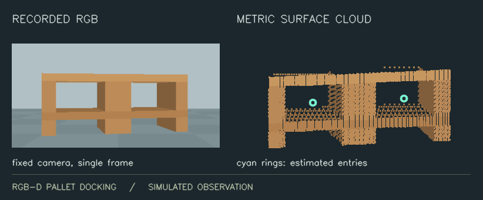

# 无人叉车的 RGB-D 托盘定位与对接验证

给出一句“取蓝色料箱下方的托盘”，程序在合成 RGB-D 场景中找出候选托盘，确认两个叉孔入口，估计它们相对车体的位置与朝向，再让虚拟双叉做一次连续插入。入口证据不足时，相机可以横移重新观察。所有核心实验都能在 CPU 上离线运行。

[观看中文演示](results/showcase/project-tour.mp4) · [浏览各阶段图像与动画](results/showcase/README.md) · [查看完整任务记录](results/missions/summary.json)



## 从指令到对接

| 阶段 | 实际实现 | 可查看的结果 |
|---|---|---|
| RGB-D 与坐标变换 | 针孔相机与实体木板求交生成轴向深度。用前平面和孔中心射线求交，移动相机验证同一世界点 | [图像叠加](sample_run/front/overlay.png) · [侧视图](sample_run/front/side.png) · [第一课](docs/first-lab.md) |
| 三维重建与自动找孔 | 从 RGB 提取木色候选，用深度生成点云，按垂直前平面约束做 RANSAC 与总最小二乘拟合，验证成对叉孔轮廓、孔距和深度 | [带颜色的 PLY 点云](results/cloud/scene.ply) · [感知实现](src/perception.py) · [Open3D 可选后端](docs/open3d.md) |
| 执行验证 | 两根有宽度和高度的矩形货叉直线前进，连续分离轴碰撞测试求首次接触，检查两叉的有效插入深度 | [成功与擦碰对照动画](sample_run/docking-demo.gif) · [裁判单测](tests/test_docking.py) |
| 重新观察 | 部分遮挡时移动虚拟相机 0.50 m，重新获取 RGB-D；持续遮挡则拒绝进入 | [初次观察](results/showcase/initial.png) · [第二次观察](results/showcase/revisit.png) |
| 语言选目标 | 专用图文模型从候选的 RGB 采样与中文指令特征中学习匹配；保留颜色与方位规则作为基线 | [模型说明](docs/semantic.md) · [选目标示例](results/semantic/selection.png) |
| 联合任务 | 同一程序串接语义选择、位姿输出、重观测和碰撞裁判。正确目标仅用于最终评测 | [选择左侧蓝箱并插入](results/missions/blue-left/record.json) · [遮挡时拒绝](results/missions/occluded/record.json) |

## 实测

180 个单托盘仿真任务覆盖 3 个距离、5 个偏航区间、3 种遮挡和 4 次独立布局扰动。对自动方法使用相同的初始观测。深度噪声标准差为 1.5 mm，随机缺测率为 0.1%。

| 决策方式 | 完成插入 / 任务数 | 已放行中碰撞或对接失败 |
|---|---:|---:|
| 已知真实位姿的几何上限 | 180 / 180 | 0 / 180 |
| 自动定位，仅首帧 | 60 / 180 | 0 / 60 |
| 自动定位，允许一次新视角 | 120 / 180 | 0 / 120 |

全部 60 个部分遮挡任务在重观测后完成，60 个严重遮挡任务持续拒绝。重观测策略已接受的 120 个任务中，入口中点三维误差中位数 **0.815 mm**、P95 **1.917 mm**，偏航绝对误差 P95 **0.0174°**。另外 4 个空场景与 4 个未指定唯一目标的双托盘场景均未放行。原始记录与分母见 [评测说明](results/benchmark/README.md) 和 [752 行策略结果](results/benchmark/trials.csv)。

图文模型与简单规则在 18 个双托盘场景、162 个限定语法任务中均答对 **162/162**。将图像变成灰度后，模型降至 **100/162**；将所有指令换成“取托盘”后为 **22/162**。语言测试统计选目标，物理对接另行验证。联合演示的 8 个指定案例中，4 个正确对接，4 个按预期返回目标缺失、指令歧义、超出语法范围或证据不足。[逐条预测](results/semantic/predictions.json) · [联合记录](results/missions/summary.json)

## 复现

下载或克隆本项目后，在根目录使用 Python 3.12：

```sh
python -m pip install -r requirements.txt
python mission.py
```

第二条命令运行覆盖选目标、对接与拒绝的 8 个案例，并为每次观察保存带标记的图像。发布包随附图文模型权重，无需模型服务。各阶段可以单独运行。

| 命令 | 产物 |
|---|---|
| `python run.py` 或 `python run.py --annotate` | 双视角几何基线；交互模式允许自己选点 |
| `python cloud_demo.py` | 彩色 PLY 和可拖动的独立点云 HTML |
| `python benchmark.py --scene T001` | 单个固定种子场景的流程回放 |
| `python benchmark.py` | 完整物理评测及失败场景 |
| `python semantic_demo.py` 或 `python semantic_demo.py --train` | 选目标评测；可选从头训练 |
| `python -m unittest discover -s tests -v` | 几何碰撞与评测计数回归检查 |

解压后打开 `results/showcase/index.html` 可离线浏览各阶段成果。仓库附带成片和动画。本次几何指标来自 NumPy 后端，Open3D 后端因本机缺少该依赖尚待实测。重新编码演示需安装 `requirements-demo.txt`、带 libass 的 FFmpeg 和可显示中文的字体。按 `python docking_demo.py`、`python demos/showcase.py`、`python demos/cloud_movie.py`、`python demos/project_movie.py` 的顺序运行。

## 适用范围

本项目是独立个人仿真作品。场景使用已标定的 RGB-D 相机、水平放置的一种木色托盘、已知双孔尺寸范围、固定样式的遮挡和少量货物颜色。动作验证覆盖双叉的直线平移，重观测采用预设机位。公网视频、公司素材、真实叉车数据均未用于该实验。测得的毫米误差适用于这些合成条件；真实传感器噪声、标定漂移、货物变形、车体导航及现场安全仍需独立验证。多模态主结果使用仓库内训练的 2,341 参数专用模型；可选的预训练 Qwen2-VL 接口不计入此次成绩。
