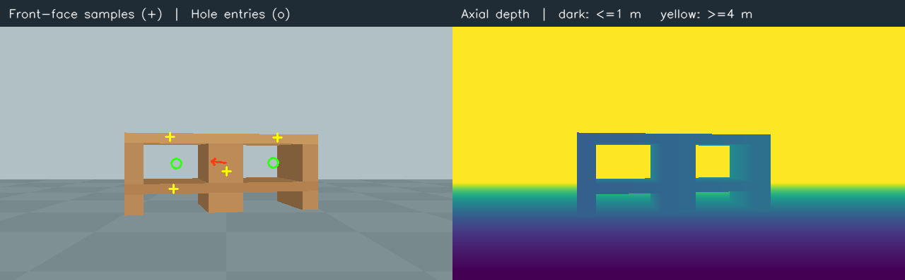

# 无人叉车 RGB-D 托盘定位 · 工单 P-001A

给一帧彩色图、米制深度图、相机标定和叉孔的二维标记，算出双孔入口中点与朝向。虚拟相机向左平移 20 cm 后，对同一托盘再做一次估计。默认流程固定随机性，全程 CPU，可离线复现。



## 在 Windows 运行

进入仓库根目录后运行。使用装有 NumPy 和 OpenCV 的 Python 3.12 环境。

```powershell
python run.py
```

在其他电脑上可用 Python 3.12 创建独立环境，再安装 requirements.txt：

```powershell
py -3.12 -m venv .venv
.\.venv\Scripts\python.exe -m pip install -r requirements.txt
.\.venv\Scripts\python.exe run.py
```

默认会重建 sample_run 下的同名输出；用 `--out 另一个目录` 可保留不同实验。第一次练习可以运行 `run.py --annotate`（使用同一解释器）。两张图中依次左键点四个分散在前面板实木上的点，再从左至右点两个叉孔的入口中心；右键撤销，Enter 确认，Esc 退出。手选结果写入 manual_run。观察孔内壁时请分清前沿与底部远端。基准标注固定在 annotations.json，无需联网或下载模型。

## 第一课：看看孔里究竟有什么

打开 sample_run/front/overlay.png。黄色十字标出用于拟合平面的实木，绿色圈标出入口中心，红箭头是进入方向的图像投影。右图是光轴深度。两个孔中心的原始深度都是 4.5 m，光线落在后墙上；射线与前平面的交点却分别在 1.948 m、2.052 m。side.png 把这两种测量画在同一张车体侧视图里，横轴向前、纵轴向上。侧视会压掉左右间距。

src/scene.py 用针孔射线和长方体表面求交生成 RGB 与 float32 轴向深度。src/geometry.py 只接收深度、标定和标注：先用 K 的逆求出实木采样点的三维坐标，用 SVD 拟合前平面，再把两个入口像素的射线与平面求交。刚体变换将交点映射到世界坐标。当前固定车体与世界坐标重合，x 向前、y 向左、z 向上；相机 x 向右、y 向下、z 向前。偏航角从世界 +x 转向 +y 为正。

## 本次验收

托盘固定，入口中点真值 (2.00, 0.00, 0.25) m，偏航 +12°。相机保持朝前，仅改变安装位置。每个视角的中点误差须小于 10 mm、偏航绝对误差小于 0.5°，两次中点距离小于 10 mm。任一项超出会打印 REVIEW，进程返回码为 1。阈值是理想几何调试用的教学约定。

| 固定像素标注 | 入口中点误差 | 偏航绝对误差 |
|---|---:|---:|
| 初始机位 | 0.81 mm | < 0.001° |
| 向左平移 20 cm | 0.90 mm | < 0.001° |

两次位置估计相差 1.70 mm。固定标注接近理想投影，前表面严格平整，深度无传感器噪声。精度衡量这条几何计算链的一致性。该工单覆盖已知叉孔像素下的入口恢复；完整项目的自动找孔、碰撞扫掠与图文选目标实验见根目录 README。

## 查看原始结果

每个视角包含 rgb.png、depth_m.npy、camera.json、pixels.json、estimate.json、overlay.png、side.png。sample_run/evaluation.json 记录独立场景真值、误差、门槛与判定。评测使用真值，估计函数不接收真值。故意将手选标注中的一个孔点向右移几像素，比较中点误差与朝向误差：中点依赖孔点，朝向来自前平面，因此两项的变化可以完全不同。
