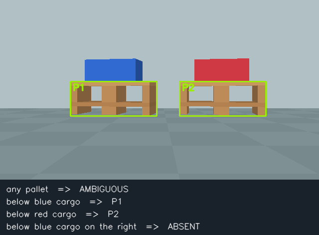

# 从“蓝箱下面”到可检查的目标编号

示例画面中有两只托盘。对接之前，需要明确用户要取哪一只。语义模块输入彩色图、几何感知模块给出的候选框与编号，以及一条中文指令。它返回一个编号、目标缺失、存在歧义、信息不足或超出语法范围。几何对接决策继续检查候选的深度、朝向和碰撞。



## 模型怎样学

这里使用从头训练的专用小型视觉语言定位器。候选托盘上方的 RGB 货物区域缩为 4×4 彩色网格，加上候选在画面中的相对左右顺序，构成视觉输入。字符串经过封闭语法检查，抽取“蓝、红、左、右”四项词汇特征；训练样本分别包含颜色、方位和两者组合。有关颜色的决定只能从输入图中获得，推理没有货物颜色元数据。

视觉分支与文字分支分别学习一个 20 维投影。融合层同时接收两种表示和逐项乘积，以逐候选的二元交叉熵和 Adam 训练一个匹配分。可学习参数共 2,341 个，存放在 [grounder_v1.npz](../models/grounder_v1.npz)。分数 ≥0.75 的候选被选中，0.25 到 0.75 的开放区间触发 UNCERTAIN；零个或多个匹配分别得到 ABSENT 和 AMBIGUOUS。分数属于此场景的匹配估计，没有作概率校准。UNSUPPORTED 用于比如“取没有蓝箱的托盘”这类语法尚未覆盖的请求。

27 个仿真训练场景（种子 11000–11026）采用监督框和标签。每组图像施加 7 次框位置/颜色扰动、9 条指令和两个候选，得到 3,402 个候选匹配样本。训练集没有独立验证集，固定训练 1,200 步，训练超参数、阈值及场景构成可在源码查看。测试使用不同位置、朝向、相机偏移和语句表达，语句共享有限词表。独立种子均复用同一种托盘形状和渲染风格，无法据此推断实车泛化。

## 对照实测

18 个固定测试场景，种子 39000–39017，每个场景 9 条指令；18 是独立渲染数。两候选需由实际几何感知提出并正确对应真值，两框 IoU 均大于 0.35 后才给决策记分。实际 18 个场景均达成该条件。评测截至选择候选，动作成功率单独计量。

| 方法 | 正确 / 任务 |
|---|---:|
| 专用可学习模型，完整 RGB 和指令 | 162 / 162 |
| 独立 HSV 颜色阈值和左右顺序规则 | 162 / 162 |
| 同一模型，将 RGB 转为灰度，保留原始指令 | 100 / 162 |
| 同一模型，保留 RGB，所有指令均换为“取托盘” | 22 / 162 |

真实标签含 38 次 P1、38 次 P2、64 次目标不存在、22 次歧义。纯色、双托盘和固定句式下，规则法已达到本组实验的上限。灰度实验显示去掉色彩会导致部分任务错误；移除指令时输出“歧义”只能命中本来就不唯一的任务。图像、语言都在影响选择。这里的实验不涵盖自由对话、开放词汇、未知物体、多机器人调度或安全认证。

## 离线复现

```powershell
python semantic_demo.py
python semantic_demo.py --train
```

第一条使用随仓库提供的权重重新测试。第二条重新生成训练样本、训练、保存权重再测试。两条都在项目根目录执行，只依赖主项目的 NumPy 和 OpenCV。每次结果写入 [metrics.json](../results/semantic/metrics.json) 和 [predictions.json](../results/semantic/predictions.json)。每帧的 9 个任务相关，汇报时同时注明任务数和场景数。延迟只覆盖选择器，渲染、候选检测、运动验证用时另计。

如已具有 Qwen2-VL-2B-Instruct 的完整本地权重以及支持 Qwen2VLForConditionalGeneration 的 Transformers、PyTorch 和 Pillow，可运行 `python semantic_demo.py --qwen-dir 本地模型目录`。此可选入口标出候选编号后，将整幅 RGB 和中文指令输入生成式模型，严格检查生成编号并将九条预测单独写入 results/semantic_qwen。参考 [官方模型卡](https://huggingface.co/Qwen/Qwen2-VL-2B-Instruct)。本项目的实测表来自随仓库提供的专用模型与规则，Qwen2-VL 预训练权重未用于该表。
