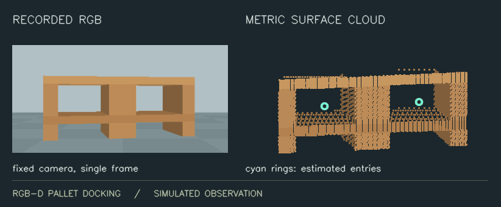

# 仿真回放

[观看 42 秒中文项目演示](project-tour.mp4) · [离线交互查看器](index.html)

克隆或解压完整项目后，用浏览器打开本目录的 `index.html`。点云可拖动旋转，三个按钮可切换正视、斜视与俯视。下图和后续回放都来自同一套可复现的合成场景。



## 从观测到动作

| 阶段 | 观察内容 | 回放与数据 |
|---|---|---|
| RGB-D | 孔中心像素记录了后墙，入口位置需要从前平面恢复 | [像素与深度](../../sample_run/front/overlay.png) · [侧视](../../sample_run/front/side.png) |
| 自动定位 | 首帧只有一个叉孔具备充分的几何证据，相机移位后验证到两个 | [首帧](initial.png) · [重观测](revisit.png) · [诊断记录](reobservation.json) |
| 插入验证 | 比较居中插入与带偏航误差的连续轨迹 | [货叉碰撞动画](../../sample_run/docking-demo.gif) |
| 语言选择 | 面对多候选、缺失与歧义指令，记录编号与拒绝结果 | [两托盘样例](../semantic/selection.png) · [测量记录](../semantic/metrics.json) |
| 完整任务 | 根据蓝箱指令选中 P1，连续扫掠验证插入 0.340 m；持续遮挡则拒绝执行 | [相机与货叉同步回放定格](mission-docked.png) · [插入记录](../missions/blue-left/record.json) · [遮挡记录](../missions/occluded/record.json) |
| 测试集 | 在相同任务上比较固定视角与至多一次重观测 | [总体结果](../benchmark/summary.json) · [恢复案例](../benchmark/replays/recovered/record.json) · [拒绝案例](../benchmark/replays/refused/record.json) |

## 重建展示

先按仓库说明生成基础回放、碰撞动画、语义结果、完整任务记录和 benchmark。从仓库根目录运行：

```sh
python demos/showcase.py
python demos/cloud_movie.py
python demos/project_movie.py
```

交互页只依赖项目已有的 Python、NumPy 和 OpenCV 环境。两个影片脚本另外调用 FFmpeg；中文 MP4 导出需要启用 libass 的 FFmpeg 以及可用的中文字体。本机使用 Microsoft YaHei。
